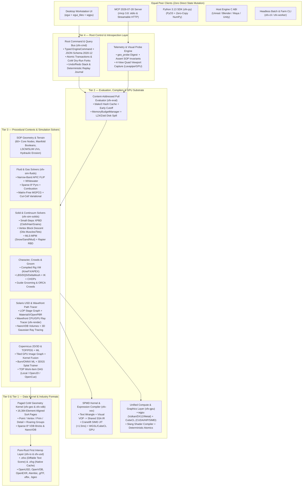

# Master Architecture & Execution Plan — Open-Source AI-Native Procedural DCC & Multiphysics Engine

> **Working Name:** `OpenFX` is **not a releasable name**: it collides with the ASWF OFX 2D image-effects standard (`ofxCore.h` / `ofxImageEffect.h`), which this engine may host in COP. Before public code or packages, choose a counsel-cleared identity; current provisional candidates are **Kinetara** (`kin`), **Asterforge** (`ast`), and **FormaFlux** (`ffx`). Until then, use neutral internal `pcc-*` package names rather than publishing `ofx-*` crates. See [`research/04-formats-interop.md`](research/04-formats-interop.md).
>
> **License:** Dual `MIT OR Apache-2.0`
> **Target Platform Baseline:** Rust 2024 Edition (`rustc 1.93+` stable), VFX Reference Platform **CY2026 / CY2027** (Python 3.13, C++20 FFI where optional, OpenUSD, OpenVDB/NanoVDB, MaterialX/OpenPBR, OpenEXR, OCIOv2), **MCP 2026-07-28 (`rmcp` 3.8+)** integrated at the root command bus.

---

## 1. Executive Summary & Core Architectural Pillars

We are building a feature-film-grade, open-source procedural 3D content-creation and multiphysics simulation platform that matches SideFX Houdini 22's capabilities while surpassing it in three foundational dimensions:

1. **MCP at the Architectural Root (True AI-Native Engine):**
   - Unlike surface-level DCC wrappers that execute raw Python strings on a GUI thread, **every mutation and query in our engine is defined once in the Root Command & Query Bus (`ofx-cmd`)** with compile-time `schemars` JSON Schema (2020-12) generation, reversible undo/redo deltas, optimistic concurrency control, and copy-on-write transactional sandboxing.
   - The **Native Desktop GUI (`ofx-ui`)**, **MCP Server (`ofx-mcp`)**, **Python 3.13 SDK (`ofx-py`)**, **CLI (`ofx-cli`)**, and **Host Engine C ABI (`ofx-engine-abi`)** are five equal peer clients of `ofx-cmd`.
   - Cooked geometry, simulation fields, and USD stages are exposed to AI agents via token-efficient **Geometry Telemetry Digests (`geo_probe`)**, **Declarative Invariant Assertions (`Assert SOP` / `geo_assert_invariants`)**, and **Headless 4-View Visual Probes (`viewport_capture`)**.
2. **Paged Copy-on-Write SIMD + Unified GPU (`CubeCL` + `wgpu` + `Slang`) Architecture:**
   - All geometry (`GeoDetail`) uses **16,384-element (`2^14`), 64-byte-aligned Structure-of-Arrays (SoA) pages (`PagedColumn<T>`)** with per-page `blake3` content hashes, constant-page compression, and transparent `lz4`/`zstd` out-of-core disk spilling.
   - All simulation solvers (APIC/FLIP, Sparse Pyro, XPBD Vellum, Vertex Block Descent Muscles, MLS-MPM, RBD) and Copernicus image operators share a single cross-vendor GPU/CPU compute layer (`CubeCL` + `wgpu`), running natively on **CUDA, ROCm, Metal, Vulkan, DX12, and multi-core CPU SIMD** from 100% stable Rust.
3. **Zero-Slop, Mathematically Verified Engineering Pipeline:**
   - Engineered specifically for autonomous AI coding agents with mechanical gates that make "AI slop" unmergeable: workspace-wide `deny(clippy::todo, clippy::unimplemented, clippy::unwrap_used)`, `#![forbid(unsafe_code)]` outside 4 Miri-audited foundation crates, **mutation testing (`cargo-mutants`)**, **thread-count determinism checks (`RAYON_NUM_THREADS=1` vs `8`)**, and **quantitative PDE/analytical physics oracles**.

---

## 2. System Architecture Diagram

---

## 3. Complete Houdini 22 Capability Parity Matrix

Every capability identified in [`research/00-houdini-capability-reference.md`](research/00-houdini-capability-reference.md) maps to a concrete crate and research design:

| Houdini 22 Context / System | Our Equivalent Crate(s) | Technical Mechanism | Detailed Spec |
|---|---|---|---|
| **SOP (Surface Operators) & `GU_Detail`** | `ofx-geo`, `ofx-sop` | 16K-element paged CoW SoA `GeoDetail`, implicit `TopologyIndex`, 60+ foundational nodes | [`01-core-architecture.md`](research/01-core-architecture.md), [`07-geometry-processing.md`](research/07-geometry-processing.md) |
| **VEX Snippets & VOP Networks** | `ofx-vex`, `ofx-expr` | Shared SSA `VexIr`, `Cranelift` AVX2/NEON JIT + `CubeCL`/WGSL GPU backend, fuel-metered sandbox | [`08-language-scripting.md`](research/08-language-scripting.md) |
| **UV Mapping (Flatten 3.0, Layout 3.0, Relax)** | `ofx-sop-uv` | Variational Autoseam, LSCM + SLIM/BFF injective parameterization (`faer`), UDIM NFP skyline packer | [`07-geometry-processing.md`](research/07-geometry-processing.md) |
| **Volumes, OpenVDB & Clouds** | `ofx-vdb`, `ofx-sop-volume` | $8^3$ sparse brick hierarchy, `vdb`/`nanovdb-rs` I/O, Fast Winding Number SDF voxelizer, cloud noise/wisps | [`02-simulation-fluids.md`](research/02-simulation-fluids.md), [`07-geometry-processing.md`](research/07-geometry-processing.md) |
| **Heightfields & Terrains** | `ofx-terrain` | 2D tiled GPU layers, analytical derivative fBm, shallow-water pipe hydraulic erosion, thermal slump | [`07-geometry-processing.md`](research/07-geometry-processing.md) |
| **POP Particles** | `ofx-sim-pop` | Paged attribute-driven particle integrator, VEX/VOP forces, spatial-hash flocking & collisions | [`02-simulation-fluids.md`](research/02-simulation-fluids.md) |
| **Pyro (Sparse Smoke, Fire, H22 GPU Pyro)** | `ofx-sim-pyro` | Dynamic $8^3$ active brick dilation, MacCormack/BFECC + Advection-Reflection, matrix-free MGPCG | [`02-simulation-fluids.md`](research/02-simulation-fluids.md) |
| **FLIP Liquids, Viscosity, Whitewater & Oceans** | `ofx-sim-flip`, `ofx-ocean` | Narrow-band APIC, cut-cell variational boundaries, implicit Stokes viscosity, Ihmsen whitewater, JONSWAP/TMA FFT ocean | [`02-simulation-fluids.md`](research/02-simulation-fluids.md) |
| **Vellum (Cloth, Hair, Grains, Soft Bodies)** | `ofx-sim-xpbd` | Small-steps XPBD, graph-colored parallel constraints, Cosserat elastic rods (hair/feathers), Tight-Inclusion CCD | [`03-simulation-solids.md`](research/03-simulation-solids.md) |
| **Otis Muscle & Tissue Solver** | `ofx-sim-vbd` | **Vertex Block Descent (SIGGRAPH 2024)** + Augmented VBD, Stable Neo-Hookean + anisotropic Hill muscle fibers | [`03-simulation-solids.md`](research/03-simulation-solids.md) |
| **MPM (Snow, Sand, Soil, Mud, Metal)** | `ofx-sim-mpm` | Sparse-brick MLS-MPM, Stomakhin snow, Drucker-Prager sand, Von Mises metal, SDF terrain colliders | [`03-simulation-solids.md`](research/03-simulation-solids.md) |
| **Bullet RBD Destruction & FEM** | `ofx-sim-rbd`, `ofx-sim-fem` | `rapier3d` deterministic RBD + XPBD glue/hinge/plastic-metal-bend constraints, 3D Voronoi cutter, `fTetWild` FEM | [`03-simulation-solids.md`](research/03-simulation-solids.md) |
| **KineFX & APEX Character Rigging** | `ofx-rig`, `ofx-deform`, `ofx-ik` | Skeletons as `GeoDetail`, compiled zero-alloc `RigGraph` VM, Geodesic Voxel/BBW weights, LBS/DQS/Delta Mush, FBIK | [`09-character-animation.md`](research/09-character-animation.md) |
| **CHOPs (Channels & Motion)** | `ofx-chop` | Time-series tracks, Spring/Jiggle oscillator, Savitzky-Golay mocap filter, FFT audio driver, foot-skate lock | [`09-character-animation.md`](research/09-character-animation.md) |
| **Hair/Fur Grooming & Feathers** | `ofx-groom` | Guide clump/frizz/part/lift, render-time `GuideDeform` interpolation, parametric rachis/barbule feathers | [`09-character-animation.md`](research/09-character-animation.md) |
| **Crowds** | `ofx-crowd` | `AgentPrim` packed definitions, Recast navmeshes, 3D ORCA collision avoidance, FSM triggers, active ragdolls | [`09-character-animation.md`](research/09-character-animation.md) |
| **Solaris (LOPs / OpenUSD)** | `ofx-usd`, `ofx-lop` | Pure-Rust `openusd` stage composition (LIVRPS, variants, payloads, instancers, `UsdShade` MaterialX) + optional `pxr` Hydra bridge | [`04-formats-interop.md`](research/04-formats-interop.md), [`05-rendering-gpu.md`](research/05-rendering-gpu.md) |
| **Karma CPU / XPU & MaterialX** | `ofx-render` | Unified CPU+GPU Wavefront Path Tracer, OpenPBR/MaterialX Slang codegen, Light BVH, Chiang hair, Random-Walk SSS, Null-Scattering NanoVDB, 3DGRT splats, LPEs, Cryptomatte, OIDN | [`05-rendering-gpu.md`](research/05-rendering-gpu.md) |
| **Copernicus (COP 2D/3D GPU Image Network)** | `ofx-cop` | $512\times 512$ tiled lazy GPU evaluator, automatic kernel fusion, OCIOv2 color management, ASWF OpenFX plugin hosting | [`05-rendering-gpu.md`](research/05-rendering-gpu.md) |
| **Machine Learning & 3D Gaussian Splats** | `ofx-ml`, `ofx-splat` | `Burn` (`CubeCL`) in-engine training + `ort` ONNX inference (SAM2, depth, ML deformer), native GPU 3DGS trainer (`Brush` architecture) + `.spz`/USD splat I/O | [`10-ml-and-orchestration.md`](research/10-ml-and-orchestration.md) |
| **PDG / TOPs & Render Farm Scheduling** | `ofx-top` | Static/dynamic work-item DAG, content-addressed cache skipping, `LocalScheduler`, **AWS OpenJD**, and **ASWF OpenCue** | [`10-ml-and-orchestration.md`](research/10-ml-and-orchestration.md) |
| **Houdini Digital Assets (HDAs) & Houdini Engine** | `ofx-graph` (`.ofxa`), `ofx-engine-abi` | Versioned `.ofxa` asset bundles with embedded self-tests; `cbindgen` C ABI + shared-memory IPC for Unreal/Blender/Maya | [`01-core-architecture.md`](research/01-core-architecture.md), [`04-formats-interop.md`](research/04-formats-interop.md) |
| **HOM Python API & Root AI Control** | `ofx-cmd`, `ofx-mcp`, `ofx-py` | Root `EngineCommand` bus, **MCP 2026-07-28 (`rmcp` 3.8)** server, Python 3.13 (`PyO3`) with zero-copy NumPy | [`06-mcp-ai-native.md`](research/06-mcp-ai-native.md), [`08-language-scripting.md`](research/08-language-scripting.md) |

---

## 4. Phased Build Plan & Concrete Milestones

The build is structured into **6 sequential Phases (24 Milestones)**. Every milestone produces a working, shippable increment that passes all 10 gates of the **Definition of Done** ([`research/11-engineering-pipeline.md`](research/11-engineering-pipeline.md)).

---

### Phase 0: Anti-Slop Engineering Harness & Foundation Kernel (Milestones M0.1 – M0.4)

**Goal:** Stand up the repository, enforced CI/audit gates (`cargo xtask`), paged `GeoDetail` memory kernel, diffable `.ofxs` scene graph, content-addressed pull evaluator, and the root `ofx-cmd` + `ofx-mcp` server.

| Milestone | Crates Delivered | Concrete Acceptance Criteria (Automated Oracles) |
|---|---|---|
| **M0.1 — Workspace, Lints & `xtask` Anti-Slop Auditor** | `xtask`, `ofx-id`, `ofx-math`, `ofx-diagnostics`, `deny.toml`, `AGENTS.md` | `cargo xtask audit` enforces zero `todo!`/`unimplemented!`/`unwrap`, crate tier DAG rules, `cargo-deny` license check, deterministic `Philox` counter PRNG, and per-page deterministic SIMD reductions (`RAYON_NUM_THREADS=1` vs `8` bit-exact). |
| **M0.2 — `ofx-geo` & `ofx-vdb` Paged CoW Geometry Kernel** | `ofx-geo`, `ofx-vdb` | 16,384-element 64B-aligned `PagedColumn<T>`, `Point`/`Vertex`/`Prim`/`Detail` attributes, `RoaringBitmap` groups, `PrimRun` (polygons, curves, tets, packed instances, VDB volumes), `blake3` page hashing. Passes `proptest` CoW page-sharing assertions and `cargo +nightly miri test`. |
| **M0.3 — `ofx-graph`, `.ofxs` Format & `ofx-eval` Cook Engine** | `ofx-graph`, `ofx-eval`, `ofx-io` (`.ofxg`, `.obj`, `.ply`, `.gltf`, `.vdb`, `.geo`/`.bgeo`) | Pull evaluator with `blake3` content cache, early cutoff, cooperative `CancellationToken`, and `lz4`/`zstd` disk spill. 100% round-trip property tests for `.ofxs` scene files and `.ofxg`/`.bgeo` geometry caches. |
| **M0.4 — Root Command Bus (`ofx-cmd`) & MCP Server (`ofx-mcp`)** | `ofx-cmd`, `ofx-mcp`, `ofx-cli` | Official `rmcp` 3.8 server (stdio + Streamable HTTP) exposing `node_catalog_search`, `node_type_inspect`, `graph_batch_edit`, `node_cook`, `geo_probe`, `geo_assert_invariants`, and atomic transactions (`begin`/`commit`/`rollback`) with full JSON Schema validation. |

---

### Phase 1: VEX/VOP Compiler, Procedural SOP Modeling & Terrain Engine (Milestones M1.1 – M1.4)

**Goal:** Deliver a complete, production-usable procedural geometry, UV, VDB, and terrain engine controllable via MCP, CLI, and Python 3.13.

| Milestone | Crates Delivered | Concrete Acceptance Criteria (Automated Oracles) |
|---|---|---|
| **M1.1 — `ofx-expr` & `ofx-vex` Compiler (VM + Cranelift SIMD JIT)** | `ofx-expr`, `ofx-vex-ir`, `ofx-vex-vm`, `ofx-vex-jit` | `@attr` parser (`logos`+`chumsky`), `miette` JSON diagnostics, fuel-metered bytecode VM, and `<1.5ms` Cranelift AVX2/NEON SIMD JIT. Differential fuzzing verifies VM vs JIT parity within $\le 1\text{ ULP}$ across 10,000 random kernels; `AttribWrangle` cooks 10M points in $<15\text{ ms}$. |
| **M1.2 — Core 35 SOP Nodes & Topological Editing** | `ofx-sop` (Part 1) | Primitives, `Transform`, `CopyToPoints`, `Scatter` (Poisson/blue-noise), `AttribPromote`/`Transfer`, `TopologyIndex`, `PolyExtrude`, `PolyBevel`, `Subdivide` (Catmull-Clark/Loop), `Sweep`, `Resample`. Verified by Gauss-Bonnet / enclosed-volume invariants. |
| **M1.3 — Guaranteed-Manifold Booleans, VDB Suite, Remesh & Fracture** | `ofx-sop` (Part 2) | `Boolean` (`manifold-rust` + Fast Winding Numbers), `VDBFromPolygons`, `VDBReshape`, `ConvertVDB`, `Remesh` (Botsch-Kobbelt), `PolyReduce` (wedge QEM), `VoronoiFracture`. Zero panics and 100% manifold/watertight output across 200 **Thingi10K** torture meshes. |
| **M1.4 — UV Suite, GPU Heightfield Terrains & Python 3.13 SDK** | `ofx-sop-uv`, `ofx-terrain`, `ofx-py` | LSCM + SLIM injective `UVFlatten` (zero flipped triangles), UDIM `UVLayout`, shallow-water pipe `HeightFieldErode` (`CubeCL`), and `PyO3` Python 3.13 bindings with zero-copy `NumPy` views. |

---

### Phase 2: Workstation UI (`egui` + `wgpu`) & 100M-Element Viewport (Milestones M2.1 – M2.3)

**Goal:** Launch the interactive desktop workstation as a pure client of `ofx-cmd`, plus headless 4-view visual probing for MCP agents.

| Milestone | Crates Delivered | Concrete Acceptance Criteria (Automated Oracles) |
|---|---|---|
| **M2.1 — `ofx-gpu` & `ofx-viewport` (100M+ Element Indirect Renderer)** | `ofx-gpu`, `ofx-viewport` | Zero-copy `PagedColumn` upload, GPU-driven frustum/Hi-Z indirect drawing, 64-bit visibility-buffer sub-pixel picking, attribute heatmaps, and headless 4-view `viewport_capture` MCP tool running on Mesa Lavapipe in CI. |
| **M2.2 — `ofx-ui` Docking Workstation & 10k-Node Network Canvas** | `ofx-ui`, `ofx-ui-nodegraph` | `egui` + `egui_tiles` multi-window docking, R-tree spatial-culled node editor rendering 10,000 nodes + wires at $>120\text{ FPS}$ ($<1\text{ ms}$ CPU), semantic LOD zoom, Houdini flags, `Y`-wire cutting, and `nucleo` fuzzy `Tab` menu. |
| **M2.3 — 50M-Row Virtual Geometry Spreadsheet, VEX Editor & Live MCP Console** | `ofx-ui-spreadsheet`, `ofx-ui-inspector` | $O(1)$ paged table inspector scrolling 50M points with zero allocation spikes, parameter expression/ramp inspector, syntax-highlighted VEX editor with `tower-lsp` diagnostics, and live Agent Activity timeline. |

---

### Phase 3: Feature-Film Multiphysics Simulation Suite (Milestones M3.1 – M3.5)

**Goal:** Deliver our six core simulation solvers on shared `ofx-vdb` sparse grids and `ofx-collision` contact infrastructure, gated by analytical physics benchmarks.

| Milestone | Crates Delivered | Concrete Acceptance Criteria (Automated Oracles) |
|---|---|---|
| **M3.1 — `ofx-collision` & `ofx-sim-rbd` Rigid Destruction** | `ofx-collision`, `ofx-sim-rbd` | `rapier3d` (`enhanced-determinism`) + XPBD glue/hinge/cone-twist/plastic-metal-bend constraint networks, `coacd` convex decomposition, dynamic fracture emission. 20-tier box pyramid stable for 300 frames; bit-identical across runs. |
| **M3.2 — `ofx-sim-xpbd` Unified Vellum-Class Solver (Cloth, Hair, Grains, Soft Bodies)** | `ofx-sim-xpbd` | Small-steps XPBD with graph-colored CPU SIMD & `CubeCL` GPU batches, anisotropic cloth triangles, Cosserat elastic rods (hair/feathers), tearing/stitching, and Tight-Inclusion CCD. Passes analytical catenary curve ($<0.1\%$ RMSE) and 100 m/s sphere-cloth zero-penetration test. |
| **M3.3 — `ofx-sim-vbd` Otis-Class Muscle, Tissue & Tetrahedral FEM Solver** | `ofx-sim-vbd`, `ofx-sim-fem` | **Vertex Block Descent (SIGGRAPH 2024)** per-vertex $3\times 3$ block Newton solver, Stable Neo-Hookean + anisotropic Hill muscle fiber contraction, `fTetWild` tet embedding, unified muscle/fat/fascia solve. Passes Euler-Bernoulli cantilever beam ($<2\%$ error) and Cook's membrane locking test. |
| **M3.4 — Sparse Matrix-Free MGPCG & `ofx-sim-pyro` Gas/Combustion Solver** | `ofx-grid-solver`, `ofx-sim-pyro` | $8^3$ dynamic sparse brick grid, cut-cell variational boundaries, matrix-free Geometric Multigrid PCG, MacCormack/BFECC + Advection-Reflection, temperature/fuel/flame thermodynamics. Passes Zalesak disk ($<1.5\%$ $L_1$ error) and Taylor-Green vortex second-order convergence ($p \ge 1.9$). |
| **M3.5 — `ofx-sim-flip` Narrow-Band APIC Liquids, Oceans & `ofx-sim-mpm` Continuum** | `ofx-sim-flip`, `ofx-ocean`, `ofx-sim-mpm` | Narrow-band APIC, ghost-fluid free surface, implicit variational viscosity, Ihmsen whitewater, anisotropic VDB surfacing, JONSWAP/TMA FFT ocean, and sparse MLS-MPM (Stomakhin snow + Drucker-Prager sand). Passes Hydrostatic Tank ($<10^{-5}\text{ m/s}$ parasitic velocity), Martin & Moyce Dam Break ($<3\%$ RMSE), and $30^\circ$ granular angle-of-repose benchmark. |

---

### Phase 4: Solaris USD Lookdev, Wavefront XPU Renderer & Copernicus 2D/3D (Milestones M4.1 – M4.3)

**Goal:** Complete end-to-end USD scene assembly, physically based CPU/GPU path tracing, and GPU image processing.

| Milestone | Crates Delivered | Concrete Acceptance Criteria (Automated Oracles) |
|---|---|---|
| **M4.1 — Solaris USD Stage Authoring (`ofx-usd`, `ofx-lop`) & Alembic/FBX Interop** | `ofx-usd`, `ofx-lop`, `ofx-io-abc`, `ofx-io-fbx` | Pure-Rust `openusd` LIVRPS composition, `Sublayer`, `Reference`, `Payload`, `VariantSet`, `PointInstancer`, `MaterialLibrary` (MaterialX/OpenPBR), plus `ufbx` and Alembic Ogawa round-trip I/O. |
| **M4.2 — `ofx-render` Wavefront CPU/GPU Path Tracer (Karma Equivalent)** | `ofx-render` | Wavefront integrator in Rust + Slang/CubeCL, two-level instanced BVH (hardware RT + SIMD BVH8), OpenPBR/MaterialX shading, Light BVH, Chiang hair, random-walk SSS, Null-Scattering NanoVDB volumes, Blackbody emission, LPEs, Cryptomatte, Deep EXR, and OIDN 2.3 denoiser. Passes White Furnace ($1.000 \pm 0.002$) and Cornell Box (NVIDIA FLIP $< 0.015$). |
| **M4.3 — `ofx-cop` Copernicus GPU Image Graph & OpenFX Plugin Host** | `ofx-cop`, `ofx-host` | $512\times 512$ lazy RoI/DoD GPU tile graph, automatic point-wise kernel fusion, OCIOv2 color management, procedural noises/filters, zero-copy live MaterialX texture feeding, and ASWF `ofxImageEffect.h` C plugin hosting. |

---

### Phase 5: Character Animation, Grooming, Crowds, ML, 3DGS & TOP Farm Pipeline (Milestones M5.1 – M5.4)

**Goal:** Complete character animation, grooming, crowds, neural workflows, 3D Gaussian Splatting, PDG/TOPs farm orchestration, and Host Engine plugins.

| Milestone | Crates Delivered | Concrete Acceptance Criteria (Automated Oracles) |
|---|---|---|
| **M5.1 — `ofx-rig`, `ofx-deform`, `ofx-ik` & `ofx-chop` Character Suite** | `ofx-rig`, `ofx-deform`, `ofx-ik`, `ofx-chop` | Compiled `RigGraph` VM ($<0.15\text{ ms}$ character eval), Geodesic Voxel & BBW weights, LBS/DQS/Delta Mush/PSD, Two-Bone/FABRIK/FBIK solvers, biped/quadruped autorig components, mocap retargeting, and CHOP procedural spring/audio channels. |
| **M5.2 — `ofx-groom` Hair/Feathers & `ofx-crowd` Simulation** | `ofx-groom`, `ofx-crowd` | Guide grooming (`Clump`, `Frizz`, `Part`, `Bend`), render-time `GuideDeform` hair procedural, parametric feathers, Recast navmeshes, 100k-agent ORCA collision avoidance, and active RBD ragdoll transitions. |
| **M5.3 — `ofx-ml` Inference/Training & `ofx-splat` 3D Gaussian Splatting** | `ofx-ml`, `ofx-splat` | `Burn` (`CubeCL`) in-engine `ML Deformer` trainer, `ort` ONNX inference (`SAM2` mask, depth estimation), native GPU 3DGS trainer (`Brush` architecture), `.ply`/`.spz`/USD `ParticleField3DGaussianSplat` I/O, and 3DGRT ray-traced splats in `ofx-render`. |
| **M5.4 — `ofx-top` (PDG) Farm Orchestration & `libofx_engine` Host Plugins** | `ofx-top`, `ofx-engine-abi`, `ofx-worker` | Static/dynamic work-item DAG, content-addressed cache skipping, `LocalScheduler`, **AWS OpenJD** & **ASWF OpenCue** farm submission, plus `cbindgen` C ABI with shared-memory IPC and reference Blender & Unreal Engine 5 plugins. |

---

## 5. Immediate Next Step (Bootstrapping Phase 0 / M0.1)

All domain research (`docs/research/00..12`) and this master plan (`docs/PLAN.md`) are in place. To begin execution immediately on **Milestone M0.1**:
1. Initialize the Git repository and root Cargo workspace (`Cargo.toml`, `rust-toolchain.toml`, `deny.toml`, `.cargo/config.toml`, `AGENTS.md`).
2. Implement `xtask` (`cargo xtask audit` & `cargo xtask ci`) enforcing the 10-point Definition of Done.
3. Implement the Tier-0 foundation crates (`ofx-id`, `ofx-math`, `ofx-diagnostics`) with 100% unit/property/determinism test coverage.
